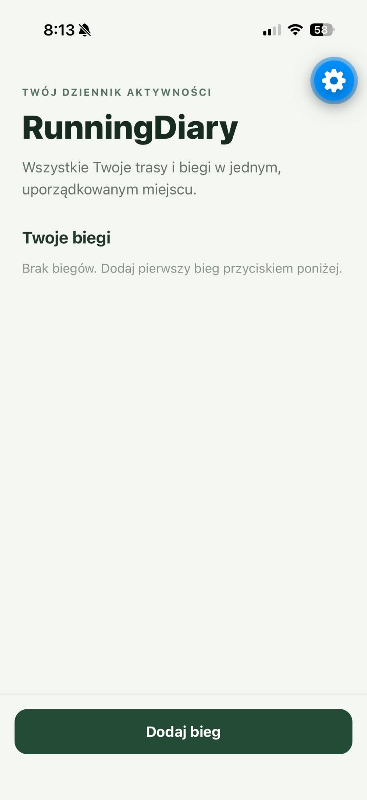
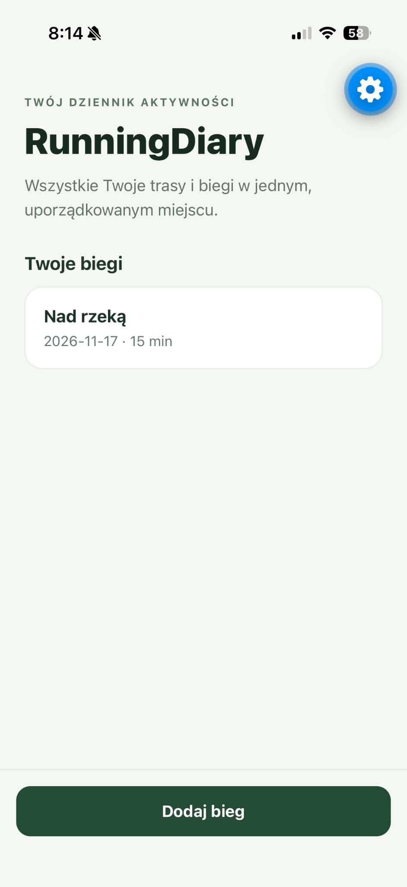
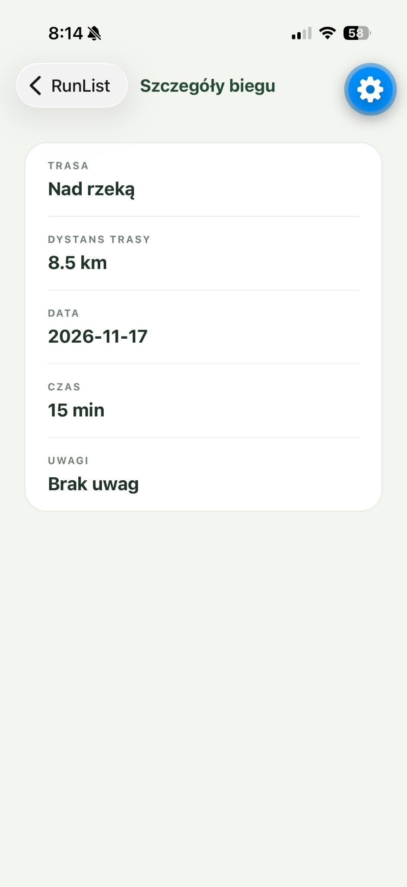
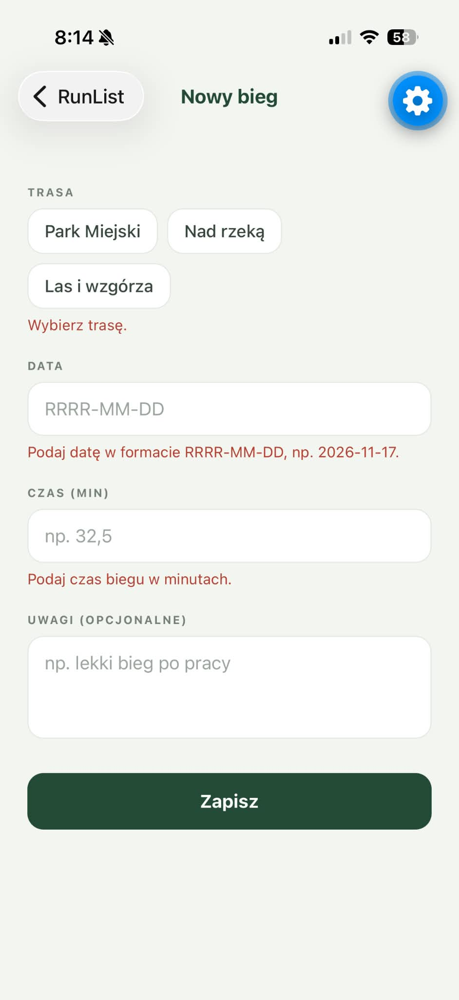

# RunningDiary

Prosta aplikacja mobilna do zapisywania tras i biegów. Projekt realizuje kartę MOB-012 ([specyfikacja](business-requirements_12.md)). Dane są zapisywane lokalnie w telefonie, bez backendu i logowania.

## Stan projektu (po laboratorium 2)

Działa:

- lista biegów, szczegóły biegu i formularz dodawania biegu (trzy ekrany z nawigacją);
- dodawanie biegu z walidacją trasy, daty i czasu (czas musi być większy od zera);
- odczyt biegów z lokalnego zapisu, który zostaje po zamknięciu aplikacji;
- trzy fikcyjne trasy demonstracyjne, tworzone przy pierwszym uruchomieniu.

Jeszcze nie ma (to plan na kolejne laboratoria, patrz [plan](docs/plan.md)):

- tworzenia i edycji tras;
- edycji i usuwania biegów oraz blokady usunięcia trasy z biegami;
- wyszukiwania, filtrowania i sortowania;
- obliczania tempa i podsumowania;
- testów automatycznych.

Aplikacja była sprawdzana ręcznie na iPhonie w Expo Go. Wyniki testów są w [sprawozdaniu z laboratorium 2](reports/lab-02.md).

## Zrzuty ekranu

| Pusta lista | Lista z biegiem | Szczegóły biegu | Walidacja formularza |
| ----------- | --------------- | --------------- | -------------------- |
|  |  |  |  |

## Technologia

React Native z Expo i TypeScript. Uzasadnienie oraz porównanie alternatyw znajdują się w [decyzji technologicznej](docs/technology-decision.md) i [porównaniu](docs/technology-comparison.md).

Biblioteki dodane w laboratorium 2:

- `@react-navigation/native` i `@react-navigation/native-stack` (z `react-native-screens` i `react-native-safe-area-context`): nawigacja między ekranami;
- `@react-native-async-storage/async-storage`: lokalny trwały zapis;
- `expo-crypto`: generowanie identyfikatorów UUID.

Stan aplikacji jest w React Context (wbudowany w React, bez dodatkowej biblioteki). Uzasadnienie wyborów jest w [architekturze](docs/architecture.md).

## Uruchomienie

Wymagane: Node.js LTS, npm, Git oraz Expo Go na telefonie. Do lokalnego uruchomienia:

```powershell
npm install
npx expo start
```

Zeskanuj kod QR w Expo Go. Środowisko bieżące ma Node.js 24.22.1

Sprawdzenie typów:

```powershell
npx tsc --noEmit
```

## Struktura projektu

```text
App.tsx          punkt wejścia: uruchamia stan i nawigację
src/
  domain/        modele (Route, Run) i walidacja
  data/          repozytorium, zapis w AsyncStorage, UUID, trasy demonstracyjne
  state/         stan aplikacji (DiaryContext)
  navigation/    nawigacja i typy ekranów
  screens/       ekrany: lista, szczegóły, formularz
docs/            wymagania, architektura, plan, decyzje technologiczne
reports/         sprawozdania i zrzuty ekranu
```

## Zakres docelowy

- pełny CRUD biegów i tworzenie/odczyt/edycja tras;
- wyszukiwanie, filtrowanie i sortowanie;
- walidacja dodatniego dystansu i czasu oraz blokada usuwania trasy z biegami;
- obliczanie tempa: czas w minutach / dystans w km;
- trwały zapis lokalny.

Co z tego jest już zrobione, opisuje sekcja "Stan projektu". Kolejność prac: [docs/plan.md](docs/plan.md).

## Dokumentacja i praca

- [Specyfikacja biznesowa MOB-012](business-requirements_12.md)
- [Wymagania MOB-012](docs/requirements.md)
- [Architektura](docs/architecture.md)
- [Plan kolejnych etapów](docs/plan.md)
- Sprawozdania: [laboratorium 1](reports/lab-01.md), [laboratorium 2](reports/lab-02.md)