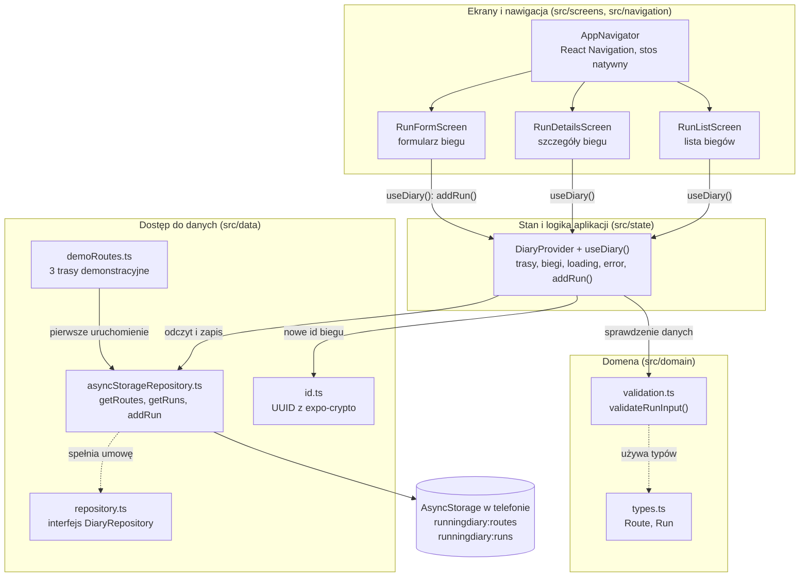

# Architektura

Dokument opisuje architekturę RunningDiary po laboratorium 2. Aplikacja ma cztery warstwy: ekrany z nawigacją, stan aplikacji, domenę (modele i walidacja) oraz dostęp do danych z lokalnym zapisem. Opisuję tylko to, co jest zaimplementowane. To, co jest dopiero planowane, jest w sekcji "Ograniczenia i dalsze prace".

## Diagram

Strzałki pokazują, kto kogo wywołuje. Ekrany nie dotykają zapisu bezpośrednio, rozmawiają tylko z `useDiary()`.

## Warstwy i pliki

| Warstwa | Pliki | Za co odpowiada |
| ------- | ----- | --------------- |
| Ekrany i nawigacja | `App.tsx`, `src/navigation/AppNavigator.tsx`, `src/navigation/types.ts`, `src/screens/*` | Wygląd, formularz i przejścia między ekranami. Szczegóły dostają `runId` |
| Stan aplikacji | `src/state/DiaryContext.tsx` | Trzyma trasy i biegi w pamięci, wczytuje je przy starcie, udostępnia `addRun` oraz stany `loading` i `error` |
| Domena | `src/domain/types.ts`, `src/domain/validation.ts` | Modele `Route` i `Run` oraz sprawdzanie danych z formularza |
| Dane | `src/data/repository.ts`, `src/data/asyncStorageRepository.ts`, `src/data/demoRoutes.ts`, `src/data/id.ts` | Odczyt i zapis w AsyncStorage, trasy demonstracyjne, generowanie UUID |

`App.tsx` składa to w jedną całość: `SafeAreaProvider` → `DiaryProvider` → `AppNavigator`.

## Model danych

- **Route (Trasa):** `id` (UUID), `name` (tekst), `distanceKm` (liczba).
- **Run (Bieg):** `id` (UUID), `parentId` (UUID trasy), `date` (tekst `RRRR-MM-DD`), `durationMin` (liczba), `notes?` (opcjonalny tekst).
- **Relacja:** jedna trasa ma wiele biegów. `Run.parentId` wskazuje `Route.id`.

Spójność relacji jest pilnowana w dwóch miejscach. `validateRunInput` nie przepuszcza biegu bez wybranej, istniejącej trasy, a `addRun` w repozytorium dodatkowo rzuca błąd, gdyby trasa nie istniała (reguła MOB-012-BR-04, część o zapisie). Blokada usuwania trasy z biegami jeszcze nie jest zaimplementowana, bo nie ma jeszcze usuwania.

## Przepływ danych po naciśnięciu "Zapisz"

1. `RunFormScreen` (`handleSave`) wywołuje `addRun(input)` z `useDiary()`. W trakcie zapisu przycisk jest zablokowany.
2. `DiaryProvider.addRun` wywołuje `validateRunInput(input, routes)`. Jeśli są błędy, zwraca je ekranowi (czerwone komunikaty pod polami) i niczego nie zapisuje.
3. Przy poprawnych danych tworzy obiekt `Run`: nowe `id` z `newId()`, czas zamieniony na liczbę (`parseDecimal`, przecinek też działa), data bez spacji, puste uwagi pomijane.
4. `asyncStorageRepository.addRun` sprawdza, czy trasa istnieje, czyta zapisane biegi i zapisuje całą listę jako JSON pod kluczem `runningdiary:runs`.
5. `DiaryProvider` czyta biegi z zapisu na nowo (`getRuns`) i ustawia stan, więc lista odświeża się sama.
6. `RunFormScreen` zamyka formularz (`goBack`) i użytkownik widzi nowy bieg na liście. Jeśli sam zapis się nie uda, pod przyciskiem pojawia się komunikat, a formularz zostaje otwarty.

## Zapis lokalny

- Trasy i biegi są zapisane jako dwie listy JSON w AsyncStorage: `runningdiary:routes` i `runningdiary:runs`.
- Przy pierwszym uruchomieniu (gdy nie ma jeszcze tras) zapisują się trzy fikcyjne trasy demonstracyjne: Park Miejski, Nad rzeką, Las i wzgórza.
- Dane są lokalne i nieszyfrowane. Aplikacja nie ma backendu.

## Decyzje projektowe

| Decyzja | Wybrane rozwiązanie | Alternatywy | Uzasadnienie |
| ------- | ------------------- | ----------- | ------------ |
| Zarządzanie stanem | React Context i własny hook `useDiary()` | Zustand, brak wspólnego stanu | Nie dodaje żadnej biblioteki. Ekrany znają tylko hook, a nie zapis |
| Przechowywanie danych | AsyncStorage | expo-sqlite, expo-file-system | Dane są małe i lokalne, API jest proste, biblioteka działa w Expo Go |
| Nawigacja | React Navigation (native stack) | Expo Router, nawigacja bez biblioteki | Pasuje do obecnej struktury projektu, daje przycisk wstecz i gest cofania na iPhonie |
| Separacja logiki od UI | Osobne warstwy `src/domain`, `src/state`, `src/data` | Logika bezpośrednio w ekranach | Magazyn można wymienić bez zmian w ekranach. `DiaryContext.tsx` importuje konkretną implementację w jednym miejscu |
| Identyfikatory | `randomUUID()` z `expo-crypto` | Pakiet `uuid`, własny generator | Mała oficjalna biblioteka Expo, prawdziwy UUID v4 |

## Ograniczenia i dalsze prace

Jeszcze nie ma:

- tworzenia i edycji tras (trasy są na razie demonstracyjne) oraz walidacji trasy (nazwa, dystans większy od zera);
- edycji i usuwania biegów oraz blokady usunięcia trasy z biegami;
- wyszukiwania, filtrowania i sortowania (lista pokazuje biegi w kolejności dodania);
- obliczania tempa (czas w minutach / dystans w km) i podsumowania;
- testów automatycznych;
- obsługi uszkodzonych danych w zapisie (kończy się komunikatem o błędzie wczytania, bez odzyskiwania).

Aplikacja była sprawdzana ręcznie tylko na iPhonie w Expo Go.