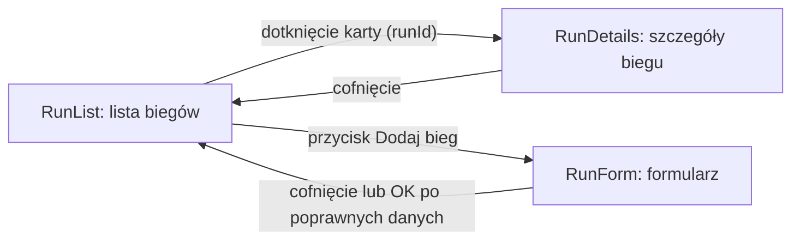
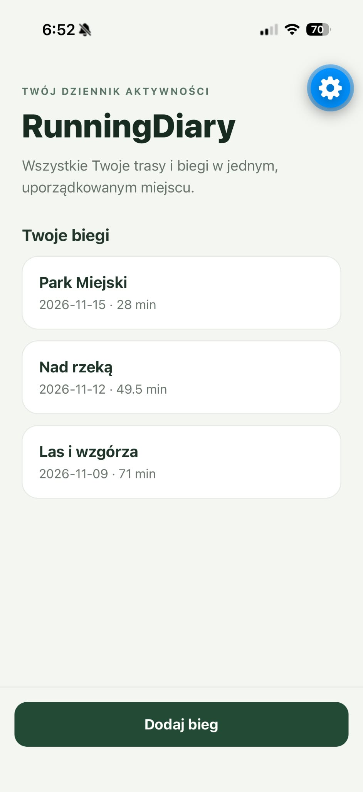
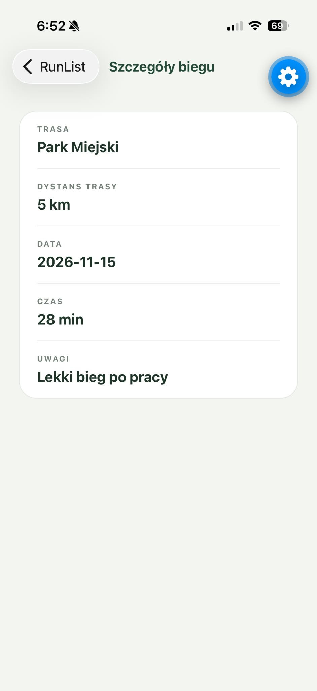
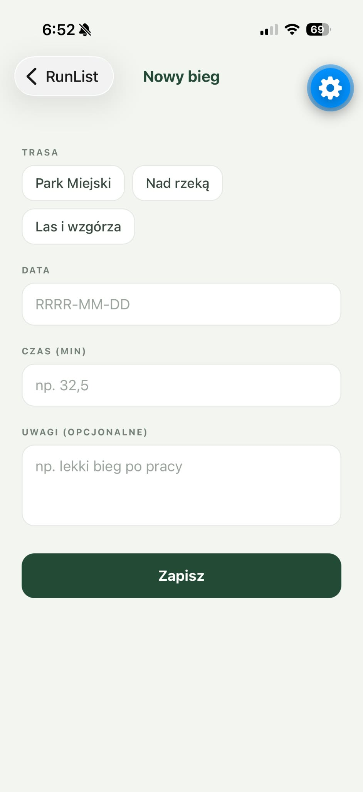
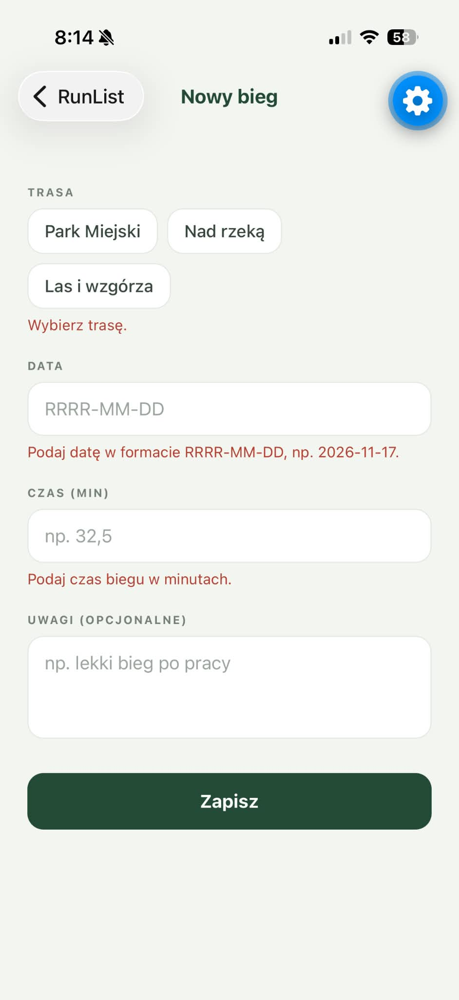
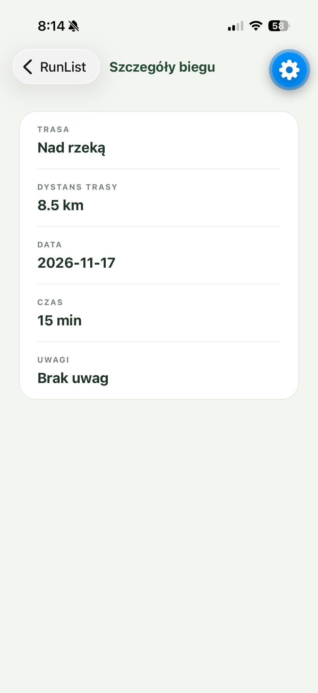
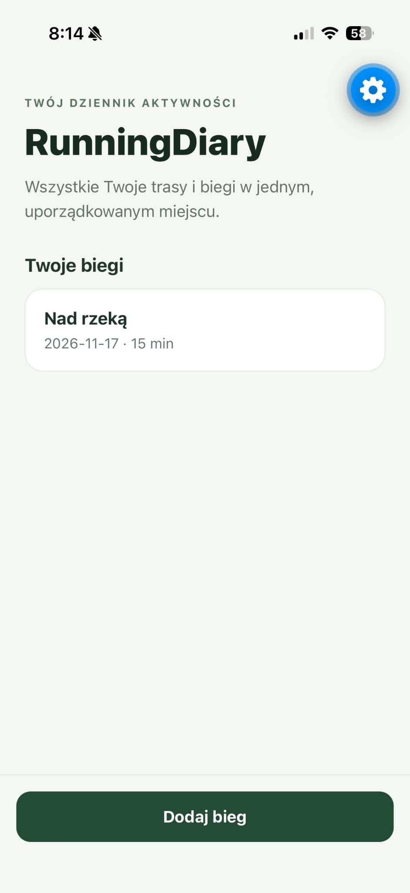
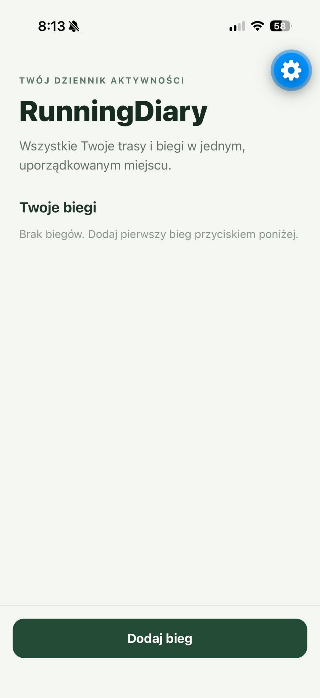

# Sprawozdanie — Laboratorium 2

**Przedmiot:** Budowa aplikacji mobilnych z użyciem technologii frontendowych  
**Student / identyfikator:** Dominik Ruszkiewicz  
**Projekt biznesowy:** MOB-012 — RunningDiary
**Framework:** React Native + Expo + TypeScript 
**Data zajęć:** [05.11.2026]  
**Repozytorium:** [github.com/rulax113/ProjektSemestralny2027](https://github.com/rulax113/ProjektSemestralny2027)  
**Commit / tag odpowiadający oddaniu:** [`cd60fb6`](https://github.com/rulax113/ProjektSemestralny2027/commit/cd60fb6c146d36fc17714d4ec13a77efc0e3cac5) (ostatni commit z kodem laboratorium 2); 
**Finalny commit z dokumentacją lub merge PR:** [merge PR #1 — 712d6ac](https://github.com/rulax113/ProjektSemestralny2027/commit/712d6ac)

> Wypełnij na podstawie własnych działań. Odpowiedzi powinny zawierać dowody (pliki, commity, PR, wyniki uruchomienia), nie same deklaracje.

## T1. Analiza podejść do tworzenia aplikacji

**Cel:** świadomy wybór podejścia w kontekście wymagań własnego projektu.

1. Wymień trzy wymagania biznesowe/niefunkcjonalne swojego projektu, które wpływają na wybór technologii.
2. Porównaj podejście natywne, hybrydowe WebView, wieloplatformowe i PWA pod kątem tych wymagań.
3. Uzasadnij, dlaczego wybrany w laboratorium 1 framework pozostaje odpowiedni, albo opisz zmianę decyzji.

| Wymaganie z projektu | Znaczenie dla wyboru technologii | Wniosek |
| -------------------- | -------------------------------- | ------- |
| W1: Formularze, listy i nawigacja (FR-01–FR-09 w MOB-012: dodawanie, lista, szczegóły, wyszukiwanie, filtrowanie, sortowanie, komunikaty błędów) | Aplikacja składa się głównie z ekranów, formularzy i list z walidacją. Potrzebuję gotowych elementów interfejsu telefonu i nawigacji między ekranami | Technologia z gotowymi komponentami UI i nawigacją, najlepiej w języku, który znam |
| W2: Trwały zapis lokalny bez backendu (FR-11, zakres: jedna osoba, dane lokalne) | Dane mają zostać po zamknięciu aplikacji i być tylko na telefonie. Potrzebuję lokalnego magazynu dostępnego z kodu aplikacji | Technologia z dostępnym lokalnym magazynem. W Expo sprawdziłem go w praktyce (AsyncStorage) |
| W3: Jedna aplikacja na iPhone'a i Androida, realizowana w semestrze samodzielnie na Windowsie (wymaganie niefunkcjonalne) | Piszę na Windows 11, a testuję na iPhonie. Dwie osobne aplikacje oznaczałyby dwa razy więcej pracy | Jedna baza kodu, szybkie uruchamianie na telefonie bez budowania aplikacji, język TypeScript |

**Porównanie podejść i uzasadnienie:**

| Podejście | W1 formularze i listy | W2 zapis lokalny | W3 jeden kod, Windows, samodzielnie | Ocena |
| --------- | --------------------- | ---------------- | ----------------------------------- | ----- |
| Natywne (Swift / Kotlin) | Najlepsze dopasowanie do systemu | Pełny dostęp | Dwa języki i dwie aplikacje. Do aplikacji na iPhone'a potrzebny jest Xcode, czyli komputer z macOS | Za dużo pracy jak na ten projekt |
| Hybrydowe WebView | Interfejs z HTML/JS w widoku przeglądarki, wygląd inny niż natywny | Możliwy (przez przeglądarkowy magazyn lub wtyczki) | Jeden kod, ale potrzeba narzędzia do zbudowania aplikacji na telefon | Możliwe, ale interfejs mniej "z telefonu" |
| Wieloplatformowe (React Native + Expo) | Natywne komponenty i biblioteki nawigacji | Dostępne biblioteki (AsyncStorage) | Jeden kod w TypeScript, uruchamianie w Expo Go na iPhonie bez Maca | Najlepsze dopasowanie do W1–W3 |
| PWA | Interfejs jako strona internetowa | Magazyn przeglądarki | Jeden kod, bez instalacji ze sklepu. Na iPhonie możliwości zależą od przeglądarki Safari | Możliwe, ale to nie jest aplikacja mobilna w sensie przedmiotu |

Wybrałem React Native z Expo i TypeScript, bo najlepiej spełnia wszystkie trzy wymagania naraz. Daje komponenty i nawigację do formularzy i list (W1), ma bibliotekę lokalnego zapisu, którą sprawdziłem na iPhonie (W2), i pozwala napisać jedną aplikację w TypeScript na Windowsie (W3). Natywne podejście oznaczałoby naukę dwóch języków i Xcode, a PWA nie jest aplikacją mobilną w rozumieniu tego przedmiotu.

**Decyzja z laboratorium 1 pozostaje** Moje własne doświadczenia z tego laboratorium to potwierdzają: aplikacja działa na iPhonie w Expo Go, a zapis lokalny przetrwał ponowne uruchomienie. Ryzyko, które opisałem w ADR (zgodność wersji Expo i React Native), wystąpiło w laboratorium 1 (wersja Expo Go nie pasowała do projektu) i rozwiązałem je aktualizacją projektu. Biblioteki w laboratorium 2 instaluję przez `npx expo install`, żeby wersje pasowały do siebie. Na Androidzie aplikacji nie uruchamiałem, więc to jest ograniczenie mojego sprawdzenia.

**Wskazane źródła (dokumentacja, artykuły techniczne):**

- Expo: [Create a project](https://docs.expo.dev/get-started/create-a-project/)
- React Native: [Set up your environment](https://reactnative.dev/docs/set-up-your-environment)
- Flutter: [Install](https://docs.flutter.dev/install)
- NativeScript: [Setup](https://docs.nativescript.org/setup/)
- Expo: [AsyncStorage](https://docs.expo.dev/versions/v58.0.0/sdk/async-storage/)

## T2. Projekt architektury aplikacji

**Cel:** zaprojektowanie struktury umożliwiającej dalszy rozwój i testowanie.

### T2.1. Diagram architektury

Dodaj diagram (np. Mermaid w Markdown lub obraz w `docs/diagrams/`) przedstawiający:

- ekrany i komponenty UI;
- zarządzanie stanem / logikę aplikacyjną;
- warstwę dostępu do danych;
- lokalne trwałe źródło danych;
- kierunek przepływu danych.

**Diagram / odnośnik:**

Diagram architektury (ekrany, stan, domena, dostęp do danych, lokalny zapis i kierunek przepływu) jest w pliku [docs/architecture.md](../docs/architecture.md).

Krótko: ekrany ([`src/screens`](../src/screens), nawigacja w [`src/navigation`](../src/navigation)) rozmawiają tylko z hookiem `useDiary()` ze stanu aplikacji ([`src/state/DiaryContext.tsx`](../src/state/DiaryContext.tsx)). Stan sprawdza dane regułami z [`src/domain`](../src/domain), a odczyt i zapis wykonuje przez [`src/data`](../src/data), które zapisuje JSON w AsyncStorage na telefonie.Diagram architektury (ekrany, stan, domena, dostęp do danych, lokalny zapis i kierunek przepływu) jest w pliku [docs/architecture.md](../docs/architecture.md).

### T2.2. Model danych

Zdefiniuj co najmniej dwie powiązane encje wynikające z indywidualnych wymagań biznesowych.

| Encja | Pole | Typ | Wymagane | Znaczenie |
| ----- | ---- | --- | -------- | --------- |
| Route (Trasa) | id | UUID | Tak | Identyfikator trasy |
| Route | name | tekst | Tak | Nazwa trasy |
| Route | distanceKm | liczba | Tak | Dystans w km, większy od zera |
| Run (Bieg) | id | UUID | Tak | Identyfikator biegu |
| Run | parentId | UUID | Tak | Id trasy, do której należy bieg |
| Run | date | tekst RRRR-MM-DD | Tak | Data biegu |
| Run | durationMin | liczba | Tak | Czas w minutach, większy od zera |
| Run | notes | tekst | Nie | Uwagi do biegu |

**Relacja i sposób zapewnienia spójności (np. usuwanie encji nadrzędnej):**

Jedna trasa ma wiele biegów (`Run.parentId` wskazuje `Route.id`). Funkcja `validateRunInput` w `src/domain/validation.ts` nie pozwala zapisać biegu bez wybranej, istniejącej trasy. Blokada usuwania trasy, która ma biegi, jeszcze nie jest zaimplementowana (będzie w późniejszym etapie projektu).

### T2.3. Decyzje projektowe

| Decyzja | Wybrane rozwiązanie | Alternatywa | Uzasadnienie |
| ------- | ------------------- | ----------- | ------------ |
| Zarządzanie stanem | React Context i własny hook `useDiary()` (`src/state/DiaryContext.tsx`) | Zustand, brak wspólnego stanu | Nie dodaje żadnej biblioteki. Ekrany znają tylko hook, a nie zapis. Po dodaniu biegu lista odświeża się sama |
| Przechowywanie danych | AsyncStorage (`@react-native-async-storage/async-storage`) | expo-sqlite, expo-file-system | Dane są małe i lokalne, API jest proste, biblioteka jest dostępna w Expo Go. Spójność trasa ↔ bieg sprawdza kod aplikacji, nie baza |
| Nawigacja | React Navigation (native stack) | Expo Router, nawigacja bez biblioteki | Pasuje do obecnej struktury projektu (`App.tsx` plus `src/`), nie wymaga przebudowy projektu, daje na iPhonie przycisk wstecz i gest cofania |
| Separacja logiki od UI | Osobne warstwy: `src/domain` (modele i walidacja), `src/data` (repozytorium z interfejsem `DiaryRepository`) | Logika bezpośrednio w ekranach | Ekrany nie wiedzą, jak dane są zapisane, więc magazyn można zmienić bez zmian w ekranach |

Identyfikatory UUID generuje `randomUUID()` z `expo-crypto`, w pliku `src/data/id.ts`.

**Plik `docs/architecture.md`: **Plik `docs/architecture.md`:** [docs/architecture.md](../docs/architecture.md)

## T3. Nawigacja i ekrany

**Cel:** przygotowanie struktury interfejsu aplikacji.

Zaimplementuj minimum trzy ekrany:

1. listę rekordów;
2. szczegóły wybranego rekordu;
3. formularz dodawania (może być później użyty także do edycji).

**Schemat nawigacji:**

| Ekran | Plik / komponent | Przejście do / z ekranu | Dowód działania |
| ----- | ---------------- | ----------------------- | --------------- |
| Lista | `src/screens/RunListScreen.tsx` | do Szczegółów (dotknięcie karty) i do Formularza (przycisk "Dodaj bieg") |  |
| Szczegóły | `src/screens/RunDetailsScreen.tsx` | z Listy, cofnięcie wraca na Listę |  |
| Formularz | `src/screens/RunFormScreen.tsx` | z Listy, cofnięcie wraca na Listę |  |

Nawigacja jest zbudowana w `src/navigation/AppNavigator.tsx` (React Navigation, stos natywny), a typy ekranów i przekazywanych danych w `src/navigation/types.ts`. Szczegóły dostają `runId`, czyli id wybranego biegu.

Zrzuty w tabeli powyżej pochodzą (ekrany z danymi przykładowymi, jeszcze bez zapisu). Zrzuty działającej aplikacji z trwałym zapisem są w sekcji T5.

**Dlaczego taki układ nawigacji jest odpowiedni dla użytkownika?**

Lista biegów jest ekranem startowym, bo biegacz najczęściej chce zobaczyć swoje biegi. Szczegóły i formularz są ekranami "wyżej" na stosie, więc zawsze można z nich wrócić jednym ruchem (strzałka w nagłówku albo gest od lewej krawędzi na iPhonie). Dzięki temu aplikacja zachowuje się tak, jak użytkownik zna z innych aplikacji na telefonie. Ekrany czytają dane z lokalnego zapisu (przez stan aplikacji), a formularz zapisuje nowy bieg, więc użytkownik od razu widzi go na liście.
## T4. Operacje Create i Read

**Cel:** implementacja pierwszych operacji CRUD z trwałym przechowywaniem danych.

Zaimplementuj:

- dodanie rekordu głównej encji;
- walidację minimum dwóch pól;
- zapis rekordu w lokalnym trwałym magazynie danych;
- odczyt i wyświetlenie listy rekordów;
- otwarcie szczegółów wybranego rekordu.

**Powiązanie z wymaganiami biznesowymi (ID wymagań):** [MOB-012-FR-01 (tylko dodawanie i wyświetlanie biegu), FR-03 (przypisanie biegu do trasy), FR-04 (lista i szczegóły), FR-08 (walidacja), FR-09 (komunikaty błędów i pusta lista), FR-11 (dane po ponownym uruchomieniu); reguły BR-01 (czas dodatni), BR-03 (daty i liczby), BR-04 (bieg tylko z istniejącą trasą).]

| Operacja         | Lokalizacja kodu | Reguła walidacji / zachowanie | Wynik |
| ---------------- | ---------------- | ----------------------------- | ----- |
| Create | [`DiaryContext.tsx`](../src/state/DiaryContext.tsx) (`addRun`), [`validation.ts`](../src/domain/validation.ts) (`validateRunInput`), [`asyncStorageRepository.ts`](../src/data/asyncStorageRepository.ts) (`addRun`) | Wymagane: trasa, data (`RRRR-MM-DD`, istniejący dzień), czas (liczba większa od zera). Uwagi opcjonalne. Błędne dane: zapis zablokowany i komunikaty pod polami | Bieg zapisany i widoczny na liście (TC-01 PASS); pusty formularz zablokowany (TC-02 PASS) |
| Read (lista) | [`RunListScreen.tsx`](../src/screens/RunListScreen.tsx), [`DiaryContext.tsx`](../src/state/DiaryContext.tsx) (wczytanie przy starcie), [`asyncStorageRepository.ts`](../src/data/asyncStorageRepository.ts) (`getRuns`) | "Ładowanie…" na starcie, komunikat przy błędzie wczytania, "Brak biegów…" przy pustej liście | Lista z zapisu, po restarcie nadal jest (TC-04 PASS), pusta lista z komunikatem (TC-05 PASS) |
| Read (szczegóły) | [`RunDetailsScreen.tsx`](../src/screens/RunDetailsScreen.tsx) | Bieg znajdowany po `runId`; gdy go nie ma: "Nie znaleziono biegu." | Poprawne dane biegu i trasy (TC-03 PASS) |

**Wyjaśnij przepływ danych po naciśnięciu przycisku „Zapisz”:**

1. W `RunFormScreen` naciskam "Zapisz", co wywołuje `addRun(input)` z `useDiary()`. W trakcie zapisu przycisk jest zablokowany.
2. `DiaryProvider.addRun` wywołuje `validateRunInput`. Przy błędach zwraca je ekranowi (czerwone komunikaty) i niczego nie zapisuje.
3. Przy poprawnych danych tworzy `Run`: nowe `id` z `newId()` (`expo-crypto`), czas zamieniony na liczbę, puste uwagi pomijane.
4. `asyncStorageRepository.addRun` sprawdza, czy trasa istnieje (BR-04), czyta zapisane biegi i zapisuje całą listę jako JSON pod kluczem `runningdiary:runs` w AsyncStorage.
5. Stan czyta biegi z zapisu na nowo (`getRuns`), więc lista odświeża się sama, a formularz się zamyka (`goBack`). Gdy zapis się nie uda, pod przyciskiem pojawia się komunikat, a formularz zostaje otwarty.

Ten sam przepływ jest opisany na diagramie w [docs/architecture.md](../docs/architecture.md).

## T5. Weryfikacja działania i wnioski

Przeprowadź testy manualne i podaj rzeczywiste wyniki.

| ID | Scenariusz | Oczekiwany rezultat | Wynik (PASS/FAIL) | Dowód / uwagi |
| -- | ---------- | ------------------- | ----------------- | ------------- |
| TC-01 | Dodanie poprawnego rekordu | Rekord jest zapisany i widoczny | [PASS] |  |
| TC-02 | Próba zapisu pustego wymaganego pola | Zapis zablokowany, komunikat | [PASS] |  |
| TC-03 | Otwarcie szczegółów rekordu | Poprawne dane rekordu | [PASS] |  |
| TC-04 | Ponowne uruchomienie aplikacji | Rekord pozostaje dostępny | [PASS] |  |
| TC-05 | Brak rekordów | Czytelny stan pustej listy | [PASS] | . Pustą listę uzyskałem, czyszcząc zapis na telefonie tymczasowym plikiem, bo usuwania biegu w aplikacji jeszcze nie ma |

TC-01.jpg i TC-04.png to te same zrzuty ale oba pasują do TC_1 i TC_4 ponieważ jeden to ekran główny jak i również po restarcie aplikacji.

**Najważniejszy napotkany problem i sposób rozwiązania:**

`src/domain/types.ts` polecenie `npx tsc --noEmit` zgłosiło błąd `TS1005: '}' expected`.Zabrakło ostatniej linii `};`, która zamyka typ `Run`. Dopisałem ją i `tsc` przeszedł bez błędów. Tymczasowy skrypt sprawdzający uruchamiany przez `tsx` działał mimo tego błędu, bo `tsx` nie sprawdza typów. Dlatego po każdym pliku uruchamiałem też `tsc`. Tak to nie było więcej błedów

**Co wymaga dalszej pracy przed laboratorium 3?**

- tworzenie i edycja tras (na razie są tylko trzy trasy demonstracyjne) oraz walidacja trasy (nazwa, dystans większy od zera);
- edycja i usuwanie biegów z potwierdzeniem;
- blokada usunięcia trasy, do której są przypisane biegi (BR-04);
- wyszukiwanie, filtrowanie i sortowanie listy biegów;
- obliczanie tempa i podsumowanie (FR-10);
- testy automatyczne: co najmniej jedna reguła biznesowa z testem pozytywnym i negatywnym;
- sprawdzenie aplikacji na Androidzie.

**Wnioski (3–6 zdań, odnoszące się do własnej implementacji):**

Zaimplementowałem trzy ekrany z nawigacją oraz dodawanie i odczyt biegów z trwałym zapisem w AsyncStorage. Kod podzieliłem na warstwy (domena, dane, stan, ekrany), dzięki czemu ekrany nie wiedzą, jak dane są zapisane, a walidacja jest w jednym miejscu. Stan trzymam w React Context bez dodatkowej biblioteki, bo przy tej skali aplikacji wystarczył. Testy ręczne TC-01 do TC-05 na iPhonie w Expo Go zakończyły się wynikiem PASS. Ograniczeniem jest zakres: nie ma jeszcze edycji i usuwania, tras własnych, tempa ani testów automatycznych, a aplikację sprawdzałem tylko na jednym telefonie.

## Materiały dowodowe i historia pracy

- Issue(s): [uzupełnię po sprawdzeniu]
- Pull Request(s): [uzupełnię po sprawdzeniu] (branch `feature/lab-02-stage1`)
- Commity związane z laboratorium:
  - [`a53db3e`](https://github.com/rulax113/ProjektSemestralny2027/commit/a53db3ee1c4628c929d03f0152fa29b648a84a4f): feat: add route and run models with validation
  - [`39d3783`](https://github.com/rulax113/ProjektSemestralny2027/commit/39d37830250c0a6f7285441b7dfaf794d4ef198b): feat: add local storage and UUID generation
  - [`6e071ba`](https://github.com/rulax113/ProjektSemestralny2027/commit/6e071bac01bf98e4463313701f21d79102a8ca14): feat: add navigation and three run screens
  - [`cd60fb6`](https://github.com/rulax113/ProjektSemestralny2027/commit/cd60fb6c146d36fc17714d4ec13a77efc0e3cac5): feat: connect screens to local storage and app state
  - commit z dokumentacją i sprawozdaniem: [`9c882e0`](https://github.com/rulax113/ProjektSemestralny2027/commit/9c882e0689695ef5dcf51ae32a3ad1b1e4e1cd29)
- Diagramy: [docs/architecture.md](../docs/architecture.md) (architektura), schemat nawigacji w sekcji T3 tego sprawozdania
- Zrzuty ekranu: [reports/assets/lab-02/](assets/lab-02/)
- Instrukcja uruchomienia: [README](../README.md)

## Użycie narzędzi AI (jeżeli dotyczy)

**Narzędzie i zakres wsparcia:** Korzystałem z ChatGPT i Claude’a. Prosiłem je o wyjaśnianie wymagań, propozycje kodu i pomoc przy błędach. Kod z odpowiedzi wklejałem do projektu, a następnie dostosowywałem do swoich potrzeb. Niektóre propozycje zawierały błędy, które sprawdzałem i poprawiałem podczas uruchamiania aplikacji. 
**Jak zweryfikowano wynik:** `npx tsc --noEmit` po kolejnych plikach, uruchomienie aplikacji w Expo Go na iPhonie, testy ręczne TC-01 do TC-05, sprawdzenie dokumentacji bibliotek, przeczytanie i poprawienie tekstów dokumentacji.  
**Elementy wykonane samodzielnie:** Sam wybierałem rozwiązania, uruchamiałem aplikację, poprawiałem błędy w kodzie i uruchamianiu, wykonywałem testy ręczne, obsługiwałem repozytorium GitHub commity branche. 

**Warunki formalne:** sprawozdanie w Markdown, czytelne odnośniki do działającego kodu i diagramów, zrzuty ekranu renderujące się w repozytorium, identyfikacja autora i projektu. Oceniana jest zarówno implementacja, jak i zdolność wyjaśnienia własnych decyzji. Brak dowodów wykonania może ograniczyć liczbę punktów.